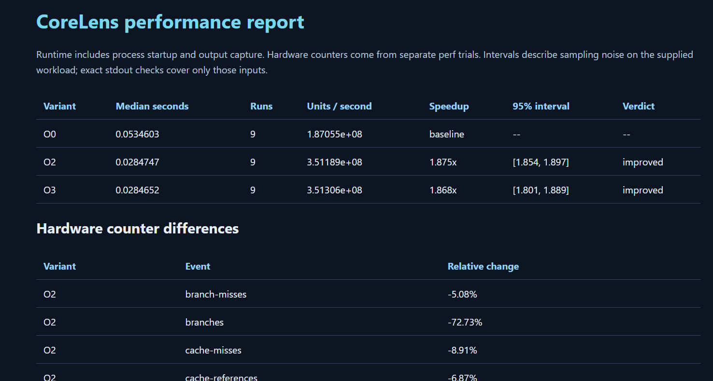
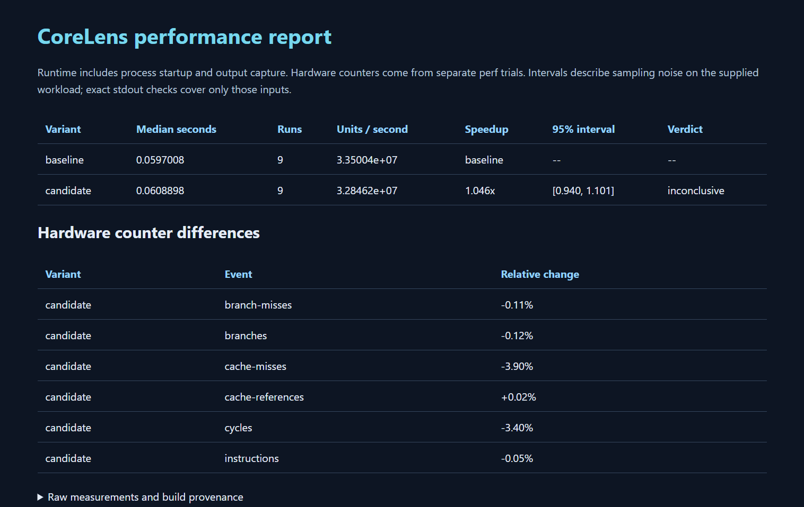

# CoreLens

A **C++ CPU performance profiler and optimization advisor** that measures compiled programs, inspects LLVM assembly, and checks whether optimization experiments actually improve a workload.

**Stack:** C++17 · LLVM / Clang · Linux perf · Python 3.10+ · CMake

On an AMD Ryzen 7 6800HS in WSL2, **O2/O3 achieved about 1.87× the throughput of O0** on the included arithmetic workload. A separate O2 → O3 vector experiment was **inconclusive**, so CoreLens did not claim a confirmed gain.

## What it does

- **Profile:** collect cycles, instructions, cache references/misses, branches, and branch misses; derive IPC and miss ratios with explicit counter availability and multiplexing data.
- **Explain:** inspect x86/AArch64 assembly for division, branch/call density, stack traffic, and scalar floating point patterns; suggest experiments and read LLVM optimization remarks.
- **Compare:** build O0/O2/O3 variants, randomize trial order, check stdout agreement, and calculate throughput and paired bootstrap confidence intervals.
- **Evaluate:** compare candidate compiler flags or source changes, then export JSON, standalone HTML, and Markdown reports.

The C++ engine handles process execution, deadlines, output capture, perf parsing, and disassembly. Python handles compilation, scheduling, statistics, experiments, and reports. [Architecture →](docs/architecture.md)

## Measured results

These are the supplied measurements. Each variant used **9 measured runs after 2 warmup rounds**. Runtime includes startup and output capture; hardware counters come from separate perf trials. All compared outputs matched.

Speedup is the **median of paired trial ratios**, which can differ from dividing the displayed median runtimes. A 95% interval containing 1 produces `inconclusive`.

### Linux / WSL2: compiler comparison

**Host:** AMD Ryzen 7 6800HS · Ubuntu 26.04 / WSL2 · kernel 6.18.33.2 · Clang 21.1.8.

**Workload:** `arithmetic.cpp`, 10,000,000 logical iterations per invocation.

| Optimization | Median runtime | Million iterations/s | Speedup vs O0 | 95% interval | Verdict |
| --- | ---: | ---: | ---: | --- | --- |
| O0 | 53.460 ms | 187.05 | Baseline | N/A | N/A |
| O2 | 28.475 ms | 351.19 | 1.875× | [1.854, 1.897] | Improved |
| O3 | 28.465 ms | 351.31 | 1.868× | [1.801, 1.889] | Improved |

All six counters were available in **9/9 trials**, with **100% reported running time**.

| Hardware event | O2 vs O0 | O3 vs O0 |
| --- | ---: | ---: |
| CPU cycles | −50.88% | −50.88% |
| Instructions | +63.29% | +63.28% |
| Branches | −72.73% | −72.76% |
| Branch misses | −5.08% | −5.15% |
| Cache references | −6.87% | −6.39% |
| Cache misses | −8.91% | −4.98% |

O2 and O3 had similar median runtimes. More retired instructions alongside fewer cycles illustrates why instruction count alone does not determine performance; aggregate counters do not establish which compiler transformation caused the change.



[Samples, counters, compiler commands, and environment →](docs/results/wsl-comparison.json)

### Linux / WSL2: optimization experiment

**Workload:** `vector.cpp`, 2,000,000 elements. O2 baseline versus O3 candidate, using the same host/compiler. Throughput counts final output elements.

| Variant | Median runtime | Million elements/s | Paired speedup | 95% interval | Verdict |
| --- | ---: | ---: | ---: | --- | --- |
| O2 baseline | 59.701 ms | 33.50 | Baseline | N/A | N/A |
| O3 candidate | 60.890 ms | 32.85 | 1.046× | [0.940, 1.101] | Inconclusive |

| Hardware event | Candidate vs baseline |
| --- | ---: |
| CPU cycles | −3.40% |
| Instructions | −0.05% |
| Branches | −0.12% |
| Branch misses | −0.11% |
| Cache references | +0.02% |
| Cache misses | −3.90% |

The paired estimate and marginal medians point in different directions, and the interval includes 1: **this experiment does not establish a runtime improvement**. Small counter differences alone are insufficient to accept the candidate.

<details>
<summary>View the experiment report</summary>



</details>

[Experiment samples and provenance →](docs/results/wsl-experiment.json)

<details>
<summary>Earlier Windows timing-only results</summary>

Windows 11 · Clang 22.1.4 · the same workload inputs · 9 runs / 2 warmups. These runs used `--units 1`, so throughput means whole program invocations per second. Hardware counters were not requested.

| Arithmetic variant | Median runtime | Runs/s | Speedup vs O0 | 95% interval | Verdict |
| --- | ---: | ---: | ---: | --- | --- |
| O0 | 111.172 ms | 9.00 | Baseline | N/A | N/A |
| O2 | 79.539 ms | 12.57 | 1.399× | [1.375, 1.438] | Improved |
| O3 | 79.688 ms | 12.55 | 1.395× | [1.198, 1.442] | Improved |

| Vector variant | Median runtime | Runs/s | Paired speedup | 95% interval | Verdict |
| --- | ---: | ---: | ---: | --- | --- |
| O2 baseline | 81.339 ms | 12.29 | Baseline | N/A | N/A |
| O3 candidate | 80.766 ms | 12.38 | 1.015× | [0.854, 1.022] | Inconclusive |

Different compiler versions and startup environments prevent attributing differences between Windows and WSL solely to the operating system.

[Comparison data](docs/results/windows-comparison.json) · [Experiment data](docs/results/windows-experiment.json)

</details>

Results are specific to these inputs and this machine. Advice uses static assembly heuristics and aggregate counters; **sampled hot-function profiling is not implemented**. Stdout checks cover supplied inputs, not complete correctness. Linked snapshots preserve measurements and provenance while omitting bulky assembly/remark payloads. [Methodology →](docs/methodology.md)

## Quick start

Requirements: CMake 3.20+, a C++17 compiler, Python 3.10+, and LLVM tools for assembly/optimization records. Python runtime code uses only the standard library.

```bash
git clone https://github.com/vishalss1/corelens.git
cd corelens
```

Run the following commands from the project folder, wherever you saved it. Build and report paths are relative to that folder.

### Linux or Ubuntu in WSL2

```bash
sudo apt update
sudo apt install clang llvm cmake ninja-build python3
cmake -S . -B build-linux -G Ninja \
  -DCMAKE_CXX_COMPILER=clang++ -DCMAKE_BUILD_TYPE=Release
cmake --build build-linux
export PYTHONPATH="$PWD/python"

python3 -m corelens --native ./build-linux/corelens-native \
  compare workloads/arithmetic.cpp --arg 10000000 --units 10000000 \
  --repeats 9 --warmups 2 --assembly --remarks --output out/comparison.json

python3 -m corelens report out/comparison.json --destination out/report.html
```

**Add hardware counters:** install your distribution's perf tools; on Ubuntu, `sudo apt install linux-tools-generic`. Check event access:

```bash
sudo perf stat -e cycles,instructions,cache-references,cache-misses,branches,branch-misses -- sleep 1
```

<details>
<summary>WSL: perf complains about missing tools for the Microsoft kernel</summary>

Use the packaged executable directly instead of Ubuntu's kernel-version wrapper:

```bash
mkdir -p out/perf-bin
CORELENS_PERF_BIN=$(printf '%s\n' /usr/lib/linux-tools/*/perf | sort -V | tail -n 1)
ln -sf "$CORELENS_PERF_BIN" out/perf-bin/perf
export PATH="$PWD/out/perf-bin:$PATH"
```

Repeat the event-access check. WSL hardware events depend on the host CPU/kernel; unsupported events stay unavailable rather than becoming zero.

</details>

On the measured WSL host, event permissions required elevation for the current counter command. Run the included workload with:

```bash
sudo env PATH="$PATH" PYTHONPATH="$PWD/python" python3 -m corelens \
  --native ./build-linux/corelens-native compare workloads/arithmetic.cpp \
  --arg 10000000 --units 10000000 --repeats 9 --warmups 2 \
  --perf --assembly --remarks --output out/comparison.json
```

Where permissions already allow access, use the ordinary `python3` command with `--perf`. Regenerate the report using the Quick start report command.

### Windows: timing and assembly

Install Python, CMake, Ninja, and Clang/LLVM. From the checkout root, these PowerShell commands use the standard MSYS2 UCRT64 location; adjust it if needed.

```powershell
$env:Path = "C:\msys64\ucrt64\bin;$env:Path"
$env:PYTHONPATH = "$PWD\python"
cmake -S . -B build-windows -G Ninja -DCMAKE_CXX_COMPILER=clang++ -DCMAKE_BUILD_TYPE=Release
cmake --build build-windows

python -m corelens --native .\build-windows\corelens-native.exe compare workloads/arithmetic.cpp --arg 10000000 --units 10000000 --repeats 9 --warmups 2 --assembly --remarks --output out/comparison.json
python -m corelens report out/comparison.json --destination out/report.html
Start-Process .\out\report.html
```

Native Windows supports timing/assembly; `--perf` and `--cpu` require Linux. Reports are saved in the project's `out` folder. To open that folder in Windows File Explorer from WSL, run:

```bash
explorer.exe "$(wslpath -w "$PWD/out")"
```

Double-click `report.html` to view it in your browser. This works with projects on any Windows drive or inside WSL's filesystem.

## Try an optimization experiment

From the Linux/WSL setup above, compare O2 against O3:

```bash
python3 -m corelens --native ./build-linux/corelens-native \
  experiment workloads/vector.cpp --candidate-flag=-O3 \
  --arg 2000000 --units 2000000 --repeats 9 --warmups 2 \
  --output out/experiment.json
python3 -m corelens report out/experiment.json --destination out/experiment.html
```

Add `--perf` using the permissions setup above for counter differences. Use `--candidate-source optimized.cpp` for a source change, or replace the workload path with your C/C++ source. With the same native executable option, `analyze ./program --function compute` inspects a binary and `bench -- ./program args` benchmarks it.

See `python3 -m corelens --help` and [the workload guide](docs/workloads.md) for arithmetic, vectorization, cache-locality, branch-prediction, and C examples.

## Contributing

C++ code lives in `src/` and `include/corelens/`; Python orchestration lives in `python/corelens/`. Checks from a Linux checkout:

```bash
cmake -S . -B build-linux -DCORELENS_BUILD_TESTS=ON
cmake --build build-linux
ctest --test-dir build-linux --output-on-failure
PYTHONPATH=python python3 -m unittest discover -s tests -p test_python.py -v
PYTHONPATH=python python3 tests/integration.py --native build-linux/corelens-native
```

CI defines native/Python checks on Linux and Windows, plus compiler integration on Linux. The integration perf fixture is synthetic; the WSL results above used real hardware counters.

For contributions, explain the behavior change, relevant checks, and measurement limits. Preserve missing-counter states and include reproducible commands with benchmark claims.

[Architecture](docs/architecture.md) · [Methodology](docs/methodology.md) · [MIT license](LICENSE)
